<div align="center">

# Soft-Float Gripper
### An under-actuated, shadow-triggered soft gripper for picking floating food products out of water

**Course 059250 – Soft Robotics · Politecnico di Milano · A.Y. 2025/26**
Department of Mechanical Engineering


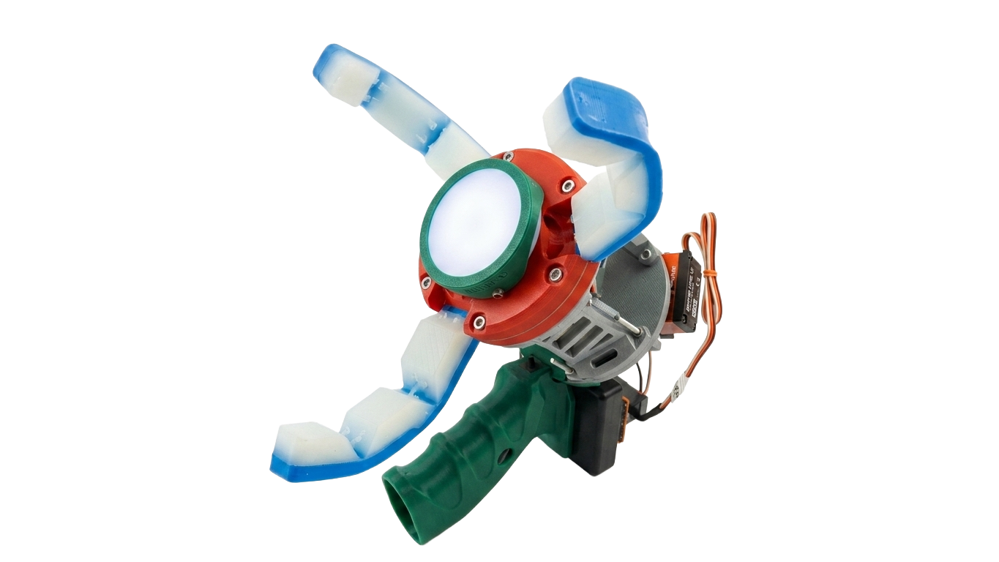

<table>
<tr>
<td>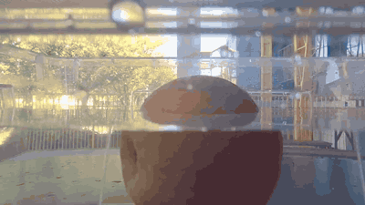</td>
<td>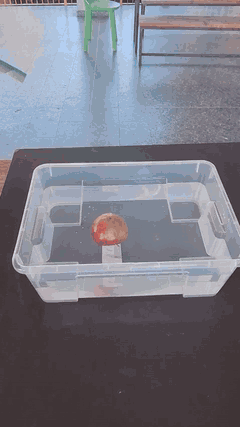</td>
<td>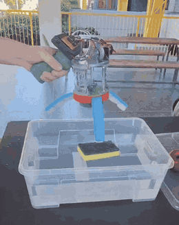</td>
</tr>
</table>

*Thomas Monaco · Christian Menini · Simone Bucci · Erwin Rafael Novicio*

</div>

---

## TL;DR

A three-finger **tendon-driven soft gripper** designed for the food industry, where products such as apples or mozzarella are often transported **floating in water channels**. The design combines:

| Subsystem | Key idea | Why it matters for wet, floating objects |
|---|---|---|
| **Soft fingers** | Bi-material cast silicone (Smooth-Sil backbone + Ecoflex pads), tapered, V-grooved "pruned-skin" texture | Compliance for delicate food; drainage channels break the water film to keep friction high |
| **Shutter configuration** | 3 fingers at 120° with a radial offset so the tips overlap instead of colliding | Self-centring, larger contact area, form-closure "cage" |
| **Whiffletree** | A single servo drives three tendons through a floating triangular differential | Under-actuation: equal tendon tension, passive shape adaptation, no finger breakage |
| **Adaptive palm** | Silicone membrane disk | Absorbs impacts from bobbing objects, self-centres them, houses the sensor |
| **Shadow sensing** | Photoresistor in the palm + auto-calibrated threshold on an Arduino Nano | Closes automatically when the object covers the palm, works from dark rooms to direct sunlight |

The prototype successfully grasped apples (the target object) as well as foam blocks, balls and sponges from a water tank.

---

## Table of contents

1. [Motivation and problem statement](#1-motivation-and-problem-statement)
2. [Grasping strategy](#2-grasping-strategy)
3. [System overview](#3-system-overview)
4. [Mechanical design](#4-mechanical-design)
   - [4.1 Soft finger](#41-soft-finger) · [4.2 Shutter configuration](#42-shutter-configuration) · [4.3 Whiffletree mechanism](#43-whiffletree-mechanism) · [4.4 Adaptive palm](#44-adaptive-palm) · [4.5 Pulley dimensioning](#45-pulley-dimensioning) · [4.6 Assembly](#46-assembly)
5. [Manufacturing](#5-manufacturing)
6. [Electronics](#6-electronics)
7. [Sensing and control](#7-sensing-and-control)
8. [Experimental results](#8-experimental-results)
9. [Conclusions and future work](#9-conclusions-and-future-work)
10. [Team and references](#10-team-and-references)

---

## 1. Motivation and problem statement

In food processing lines, many products are washed and transported **floating on water** (fruit flumes, mozzarella cooling tanks). Picking them out is still largely manual or done with rigid tools.

<table>
<tr>
<td>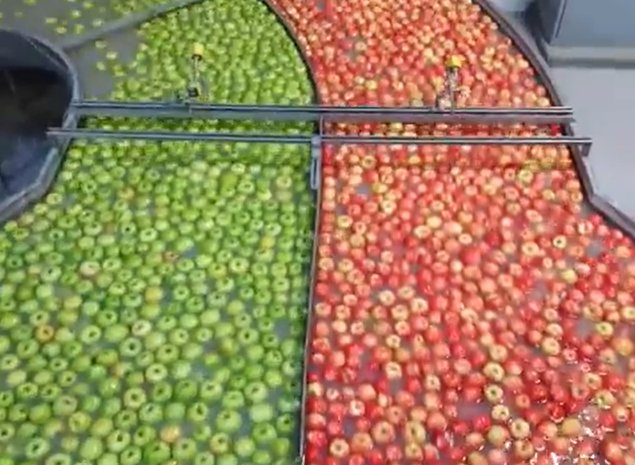</td>
<td>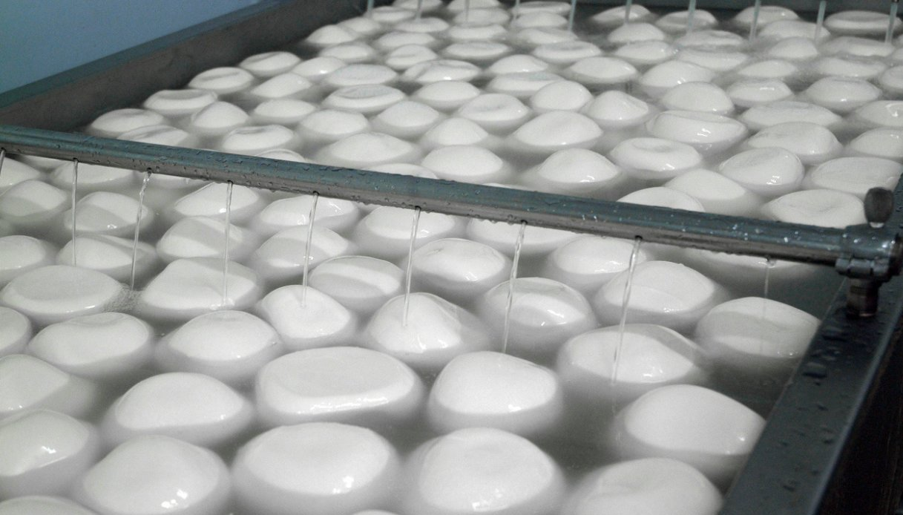</td>
</tr>
<tr><td align="center"><sub>Apples in a washing flume</sub></td><td align="center"><sub>Mozzarella in a cooling tank</sub></td></tr>
</table>

Handling wet food is hard for a robotic gripper because of:

- **Object motion** induced by hydrodynamic forces: the target bobs, drifts and rotates while the gripper approaches.
- **Irregular and variable geometry**: no two apples are the same.
- **Low friction**: a thin water film between skin and finger promotes slip.
- **High deformability** of soft products such as mozzarella.
- **Damage-free handling**: bruising is a product defect.

### State of the art

<table>
<tr>
<td align="center">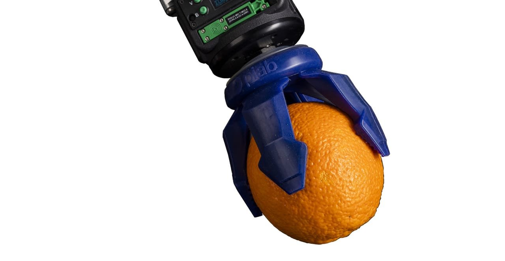<br><sub>Vacuum gripper (Piab piSOFTGRIP 100-4)</sub></td>
<td align="center">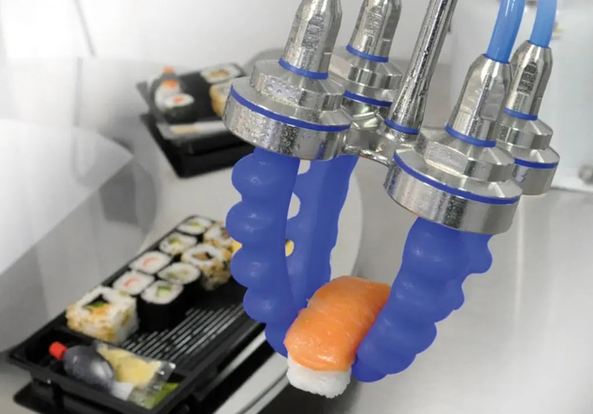<br><sub>Pneumatic elastomer gripper (Fraunhofer IVV Dresden)</sub></td>
<td align="center">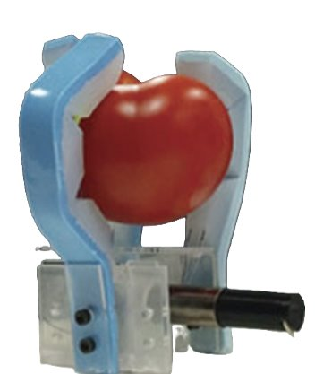<br><sub>Bio-inspired tendon gripper (Manti et al.)</sub></td>
</tr>
</table>

Existing soft grippers for food are mostly **pneumatic** (needing compressors and valves) or **vacuum-based** (which struggle on wet, porous or irregular surfaces). We targeted a **low-cost, electrically actuated, single-motor** solution designed specifically for floating objects.

---

## 2. Grasping strategy

The design was driven by a four-phase grasp sequence, defined around the challenges above:

<table>
<tr>
<td width="60%">

1. **Approach**: the gripper is positioned above the target object.
2. **Encounter**: the gripper is lowered until the soft fingers surround the object. The open fingers act as a funnel and the compliant palm absorbs the contact.
3. **Grasping**: finger closure is triggered by the palm sensor (or by the operator through the forced-closure button).
4. **Manipulation**: the grasped object is lifted out of the water and moved to the target location, then released with a button press.

This "envelop first, close second" approach is robust to the object's drift: the object does not need to be precisely located, because the fingers and palm passively centre it before closure.

</td>
<td>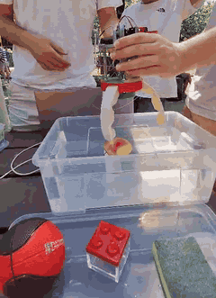</td>
</tr>
</table>

---

## 3. System overview

<div align="center">
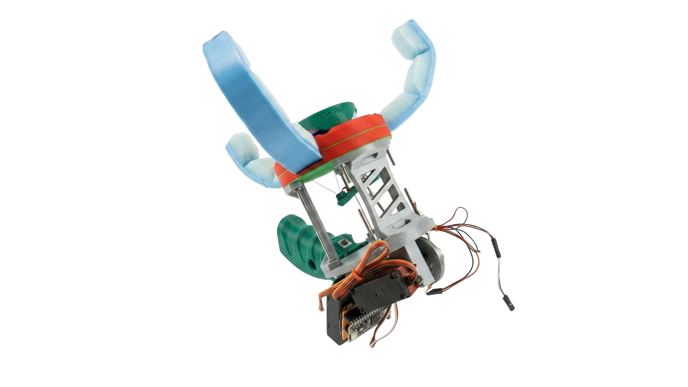
</div>

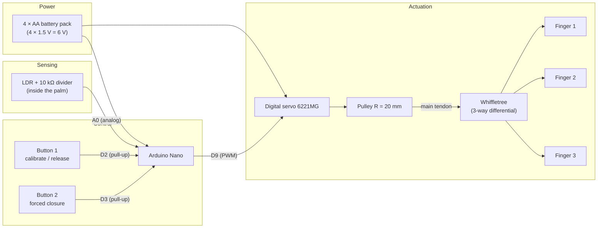

---

## 4. Mechanical design

### 4.1 Soft finger

<div align="center">
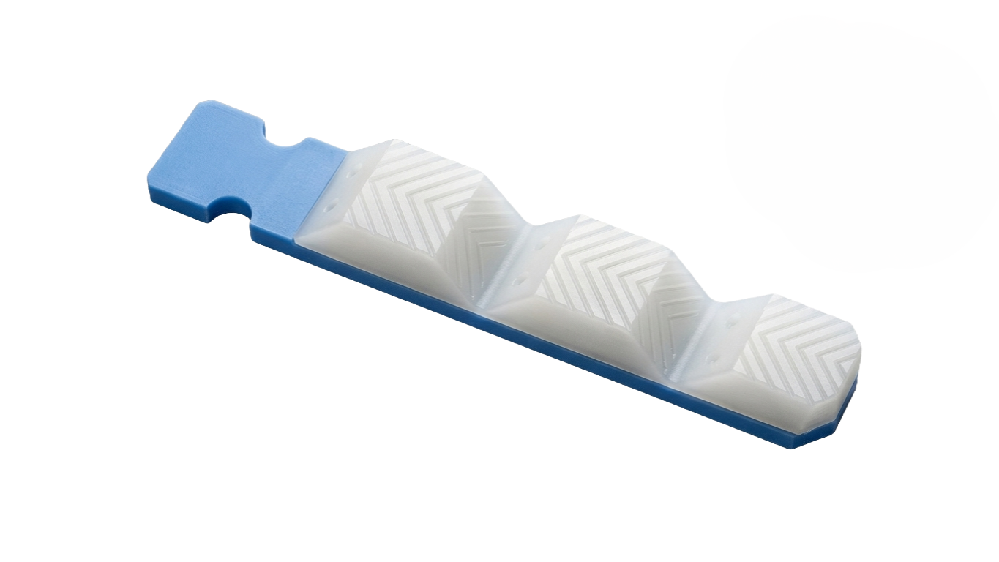
</div>

| Feature | Design choice | Function |
|---|---|---|
| **Modular snap-fit root** | Circular grooves at the finger base | Avoid stress concentrations at the clamp and allow quick finger replacement or custom configurations |
| **Tapered planform** | Width decreases from 25 mm (root) to 20 mm (tip) | Three fingers can close into a full enclosure without the tips interfering |
| **V-grooved texture** | Chevron channels on the contact pads | Bio-inspired by fingertip wrinkling ("pruning") in water: the grooves drain the fluid film and maximise wet grip |
| **Bi-material compliance** | **Smooth-Sil** backbone + **Ecoflex** compliant pads / joints | The stiffer Smooth-Sil provides elastic spring-back (passive re-opening); the very soft Ecoflex conforms to the object's shape |

#### Technical drawing

<div align="center">
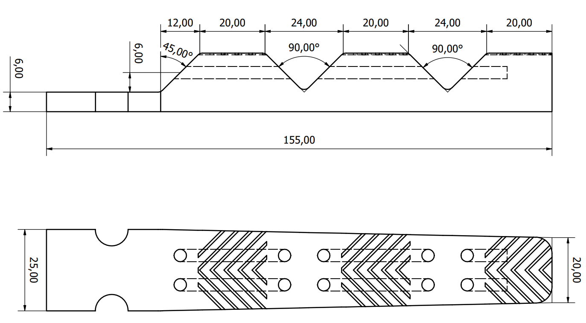
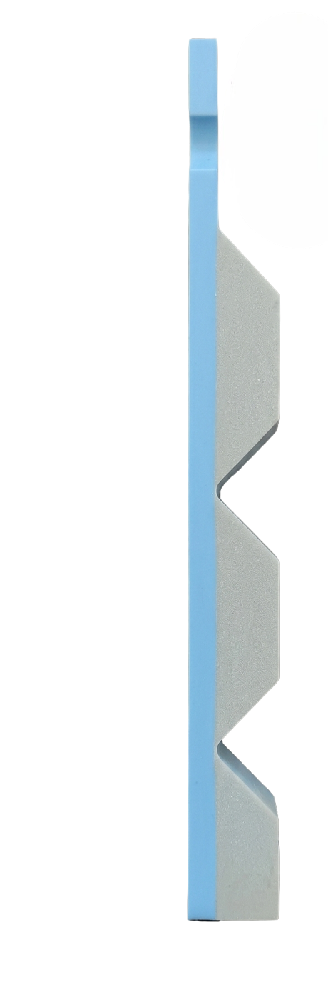
</div>

Main dimensions (mm):

| Quantity | Value |
|---|---|
| Overall length | 155 |
| Root width / tip width | 25 / 20 |
| Backbone thickness | 6 |
| Pad height above backbone | 9 |
| Segment pitches (root → tip) | 12 · 20 · 24 · 20 · 24 · 20 |
| V-notch opening angle | 90° |
| Root chamfer | 45° |

**How the finger bends.** The tendon runs through the pads at an offset $d$ from the neutral axis of the backbone. Pulling it by $\Delta L$ closes the V-notches, which act as flexure joints. For small deformations the tendon excursion is the sum of the joint rotations weighted by the moment arm:

$$
\Delta L \;\approx\; \sum_{j} d_j\,\theta_j
$$

Each 90° notch also works as a **geometric end-stop**: once its two faces touch, that joint stops rotating and the bending moves on to the next segment, which gives a progressive wrap from root to tip. When the tendon is released, the elastic energy stored in the Smooth-Sil backbone re-opens the finger with no return spring.

### 4.2 Shutter configuration

<table>
<tr>
<td width="55%">

The three fingers are mounted at **120°** around the palm, but each one is **offset radially** from the centre line, like the blades of a camera shutter. When they close, the fingers slide past each other and **overlap** instead of meeting tip to tip.

- **Collision-free grasping**: the tips cannot jam against each other, even on very small objects.
- **Larger contact area**: the overlap creates a more continuous enclosing surface and spreads pressure against the palm.
- **Self-centring**: the rotational closure naturally pushes the object toward the gripper axis.
- **Better form closure**: the overlapping "shutter" cage physically traps the object, so the grasp relies less on friction. This is especially important when the object is wet.

</td>
<td>
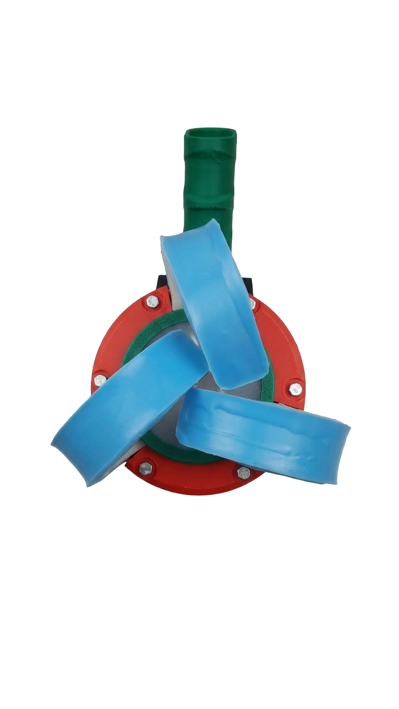<br>
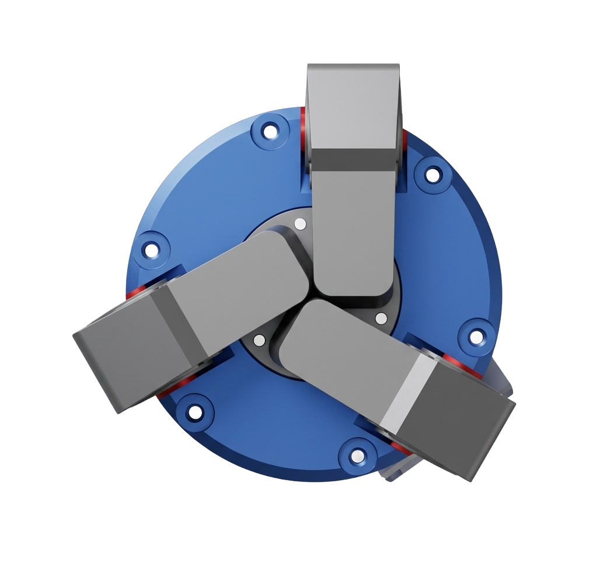
</td>
</tr>
</table>

### 4.3 Whiffletree mechanism

#### The problem: single-wire actuation

<table>
<tr>
<td width="45%">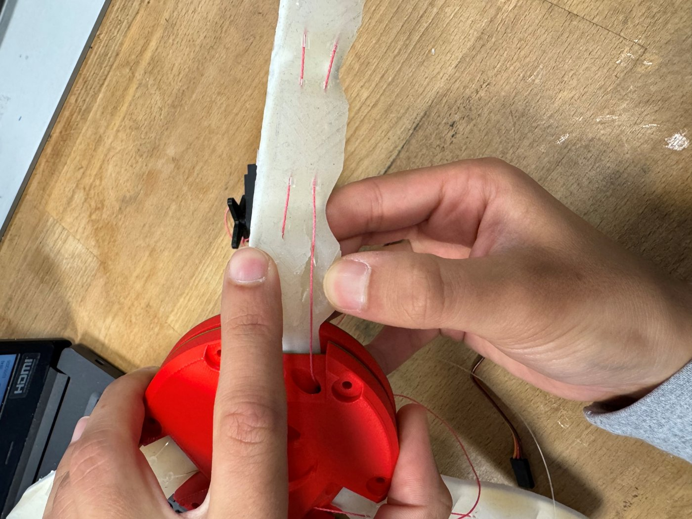</td>
<td>

The first prototype drove all three fingers with **one tendon rigidly tied to all of them**. This forces every finger to move by the same amount:

$$
\delta_1=\delta_2=\delta_3=u
$$

When the first finger touches the object it cannot move any further, but the motor keeps pulling. All of the extra input then goes into that one finger, which concentrates stress until it breaks (see photo). The other fingers stay slack and never reach the object.

</td>
</tr>
</table>

#### The solution: whiffletree (3-way mechanical differential)

<table>
<tr>
<td>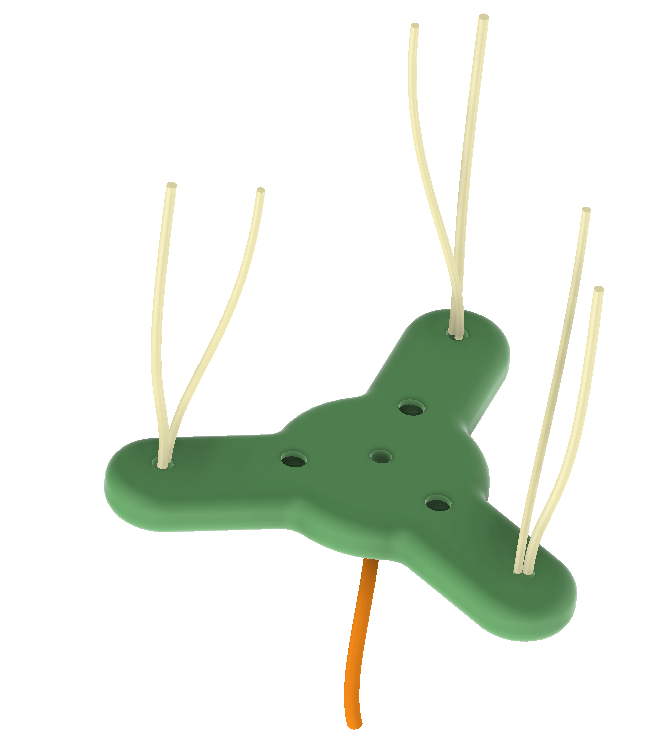</td>
<td>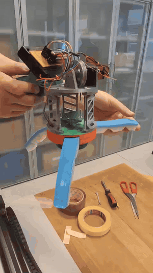</td>
</tr>
</table>

The motor tendon is attached to the centre of a **floating triangular plate**, and the three finger tendons to its vertices, which sit at equal distance $r$ from the centre. The plate is free to tilt.

**Statics.** Rotational equilibrium of the plate about any axis through its centre requires equal moments, and the attachment points are symmetric. So the input force $F$ is always split equally, whatever the finger positions:

$$
\sum_i T_i\, \mathbf{r}_i \times \hat{\mathbf{z}} = \mathbf{0}
\quad\Longrightarrow\quad
T_1 = T_2 = T_3 = \frac{F}{3}
$$

**Kinematics.** For small tilts, the centre of the plate moves by the average of the vertex displacements:

$$
u = \frac{\delta_1+\delta_2+\delta_3}{3}
$$

Consequences:

- **Under-actuated efficiency**: one motor drives three fingers, which cuts weight, cost, wiring and control effort.
- **Adaptive grasping**: when a finger is blocked by contact, the plate tilts and passes the remaining travel to the fingers that are still free. Each finger wraps around the object until all three are in contact, with no extra sensors.
- **Load protection**: no finger can receive more than one third of the motor force, which fixed the breakage seen with single-wire actuation.
- **Full stroke preserved**: with no object, $\delta_1=\delta_2=\delta_3=u$. A single displacement $\Delta L$ on the main line still closes all three fingers fully.

The plot below compares the two architectures with a simple quasi-static model. Each finger is a linear spring that becomes much stiffer once it touches the object, and the three fingers make contact at different times, as with an irregular object. The stiffness values are only illustrative (see [`scripts/make_plots.py`](scripts/make_plots.py)).

<div align="center">
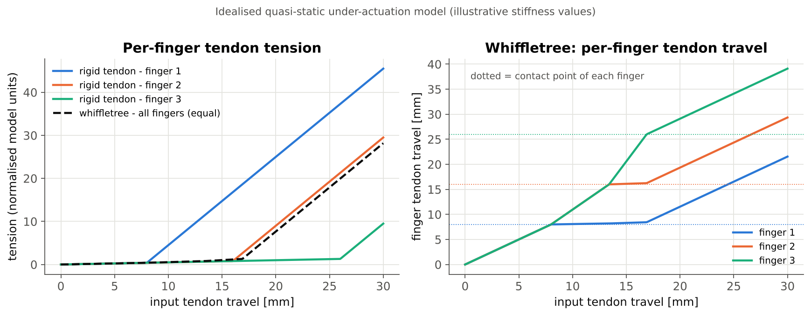
</div>

> With the rigid tendon, the first finger to make contact (blue) carries most of the load while finger 3 is barely loaded. With the whiffletree, all three tensions are identical (dashed), and each finger keeps travelling after the others stop, so the gripper conforms to the object.

<div align="center">
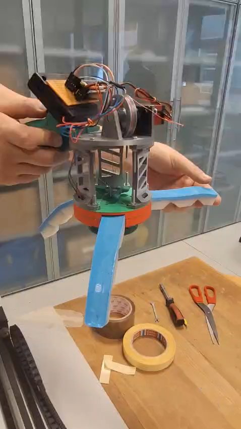
</div>

### 4.4 Adaptive palm

<table>
<tr>
<td width="50%">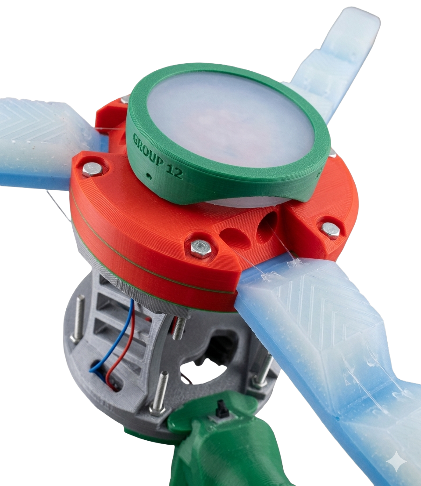</td>
<td>

The palm is a **silicone membrane disk** held in a 3D-printed frame.

- **Passive self-centring**: the membrane deflects on contact and guides the object toward the gripper axis.
- **Shock absorption**: floating objects move unpredictably, so contact often happens with a relative velocity. The membrane absorbs that impact energy instead of bouncing the object away.
- **Sensor housing**: the translucent membrane covers the photoresistor and provides the closure feedback (see [§7](#7-sensing-and-control)).

</td>
</tr>
</table>

### 4.5 Pulley dimensioning

<div align="center">
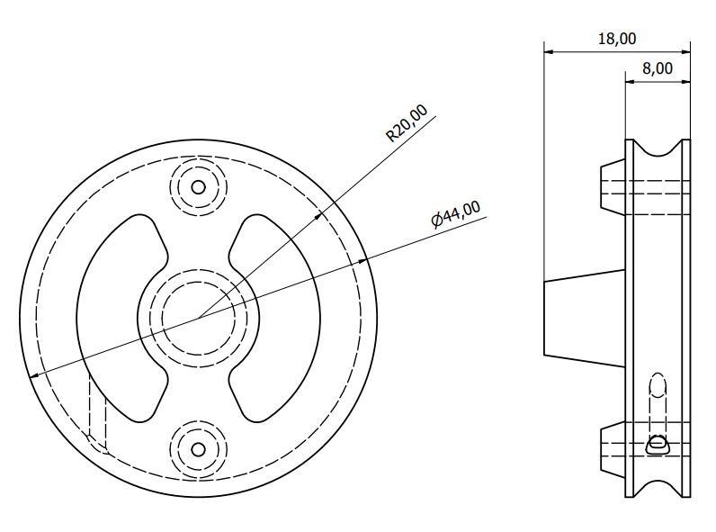
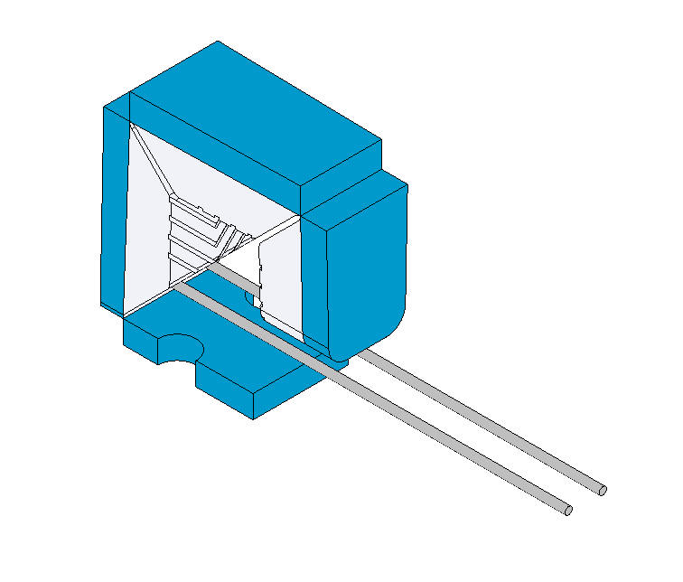
</div>

| Quantity | Symbol | Value | Source |
|---|---|---|---|
| Tendon travel for full closure of one finger | $\Delta L$ | ≈ 30 mm | CAD |
| Pulley outer diameter | $D$ | 44 mm | drawing |
| Groove (winding) radius | $R$ | 20 mm | drawing |
| Pulley width / groove width | – | 18 / 8 mm | drawing |
| Commanded servo stroke | $\theta$ | 180° → 70° = 110° | firmware |

Because the whiffletree is a parallel differential, **one stroke of $\Delta L$ on the main line closes all three fingers**. So the pulley only has to wind $\Delta L$, not $3\Delta L$. The tendon length wound by the pulley over a rotation $\theta$ is the arc length:

$$
s = R\,\theta \;\ge\; \Delta L
\qquad\Longrightarrow\qquad
R \;\ge\; R_{min} = \frac{\Delta L}{\theta}
$$

**Design check over the full 180° servo range** ($\theta=\pi$):

$$
R_{min} = \frac{\Delta L}{\pi} = \frac{30\ \text{mm}}{\pi} \approx 9.5\ \text{mm}
\;\le\; R = 20\ \text{mm}
\quad\checkmark\quad (\text{SF} \approx 2.1)
$$

**Check over the stroke actually used by the firmware** ($\theta = 110° \approx 1.92$ rad):

$$
s = R\,\theta = 20\ \text{mm}\times 1.92 \approx 38.4\ \text{mm} \;\ge\; \Delta L = 30\ \text{mm}
\quad\checkmark\quad (\text{SF} \approx 1.3)
$$

The extra ~8 mm of winding takes up tendon slack and the stretch of the whiffletree lines, and still leaves room for the whiffletree to redistribute travel between fingers.

<div align="center">
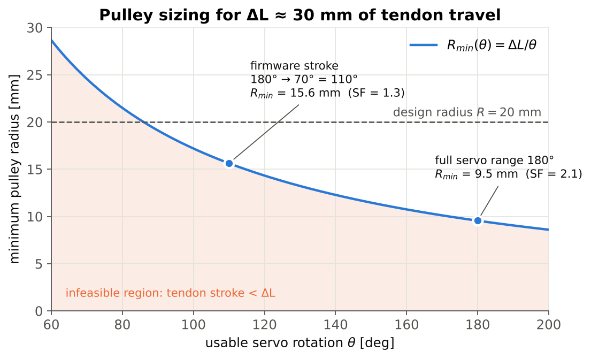
</div>

### 4.6 Assembly

<table>
<tr>
<td align="center">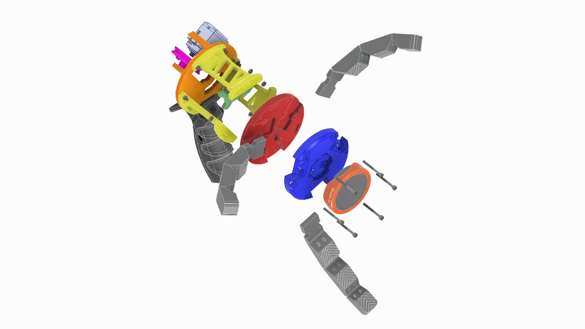<br><sub>Exploded assembly – back</sub></td>
<td align="center">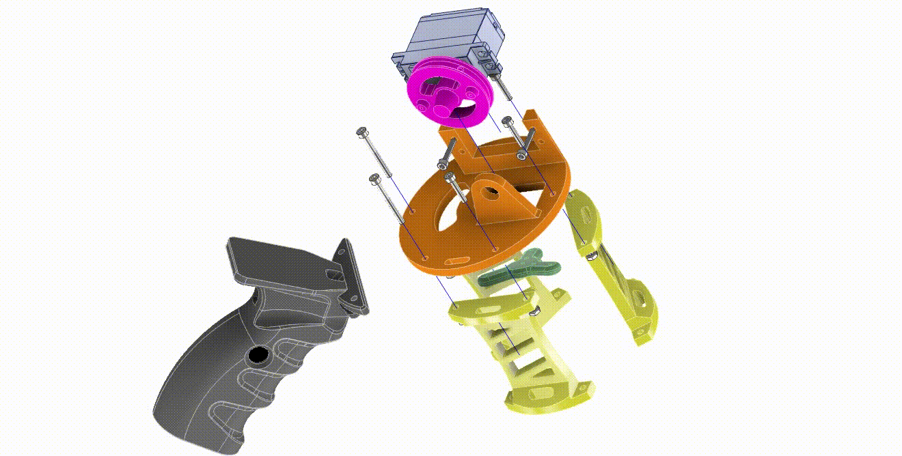<br><sub>Exploded assembly – front</sub></td>
</tr>
</table>

Stack-up from the handle to the fingers: **pistol grip → servo mount and pulley → lattice column (tendon routing and electronics) → whiffletree → finger hub (snap-fit seats at 120°) → palm frame with silicone membrane and LDR**. All rigid parts are 3D printed. Fingers clip into the hub and the tendons are threaded through the column to the whiffletree.

---

## 5. Manufacturing

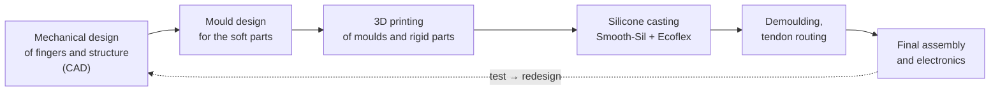

### Soft fingers

<table>
<tr>
<td align="center">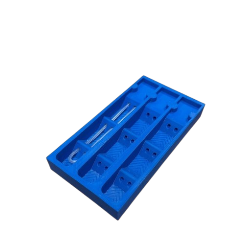<br><sub>① Multi-part mould design</sub></td>
<td align="center">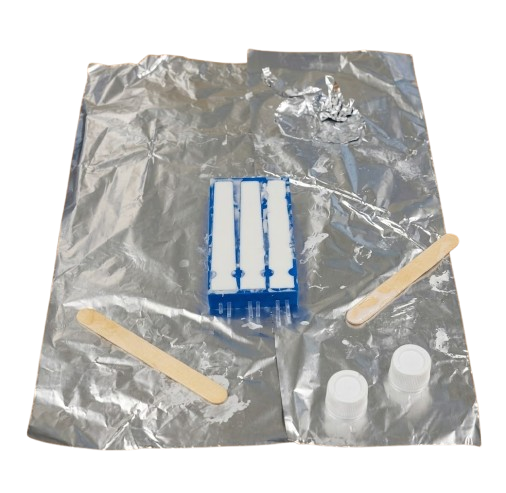<br><sub>② Silicone casting</sub></td>
<td align="center">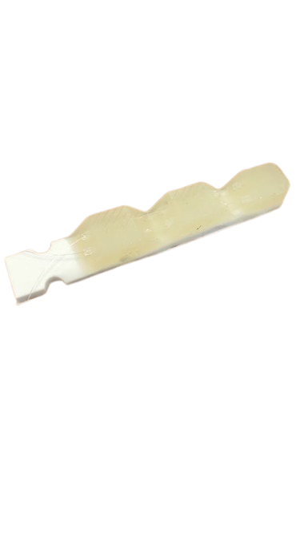<br><sub>③ First prototype</sub></td>
<td align="center">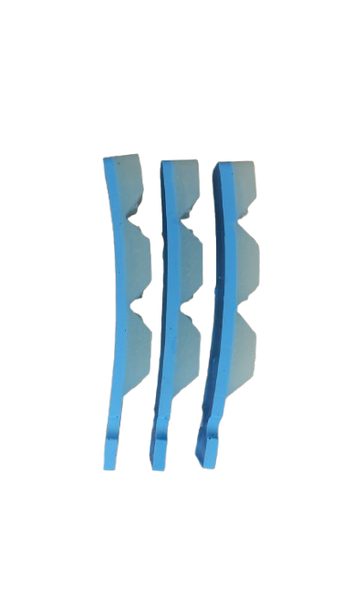<br><sub>④ Final bi-material fingers</sub></td>
</tr>
</table>

<table>
<tr>
<td align="center">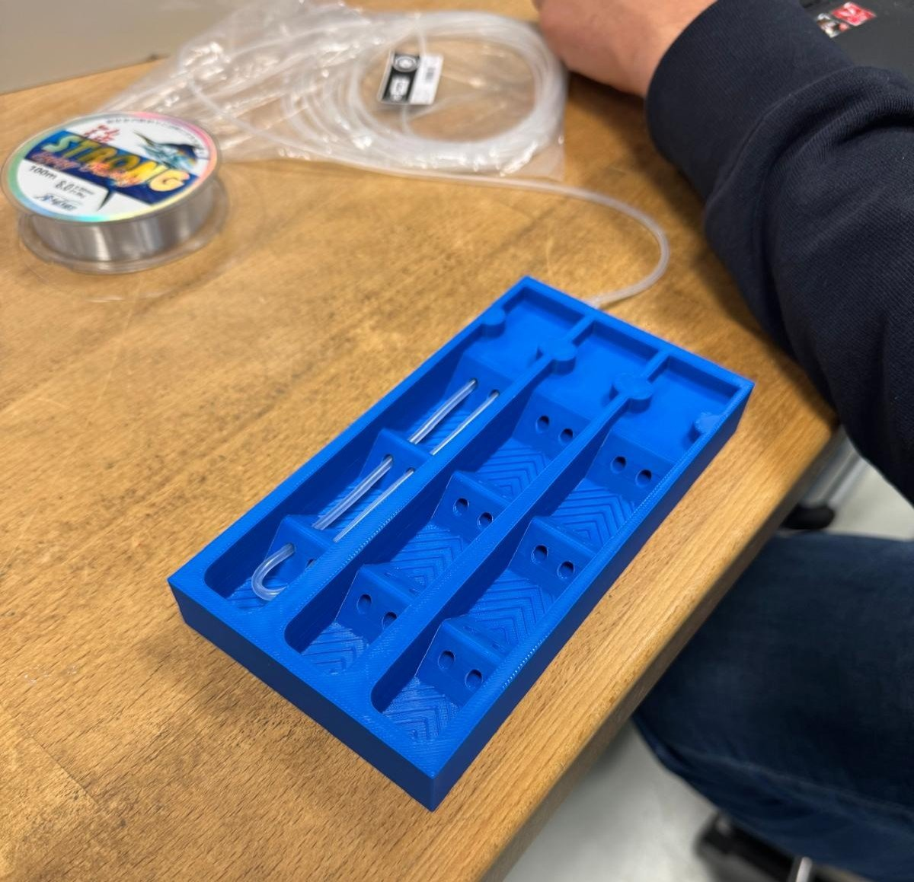</td>
<td align="center">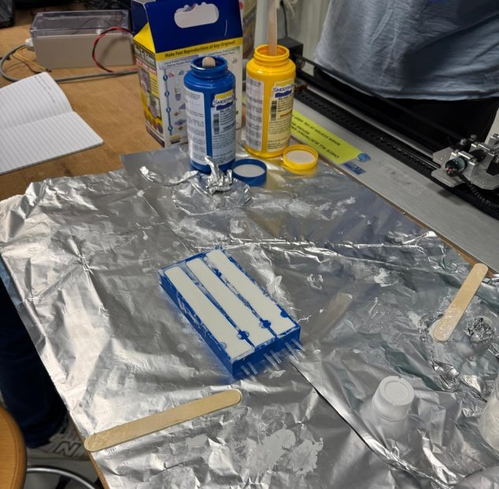</td>
</tr>
<tr><td colspan="2" align="center"><sub>3D-printed finger moulds</sub></td></tr>
</table>

The soft parts were cast in 3D-printed multi-part moulds. The final fingers combine a **Smooth-Sil backbone** (blue), which gives structural spring-back, with **Ecoflex** compliant regions carrying the V-groove texture. Silicone-to-silicone casting avoids glued interfaces that could peel off in water. The first single-colour prototype was used to validate the geometry before moving to the bi-material version.

### Palm

<table>
<tr>
<td align="center">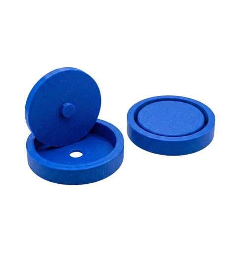<br><sub>① Palm mould design</sub></td>
<td align="center">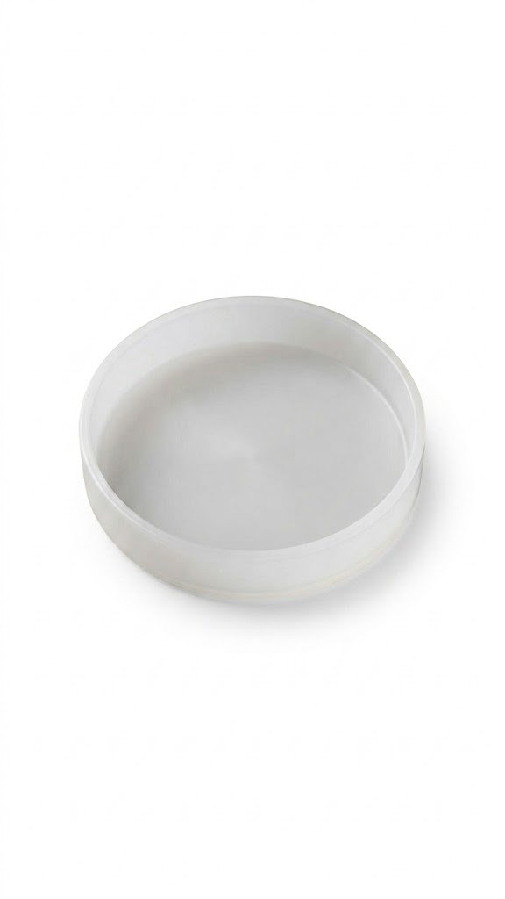<br><sub>② Silicone palm casting</sub></td>
<td align="center">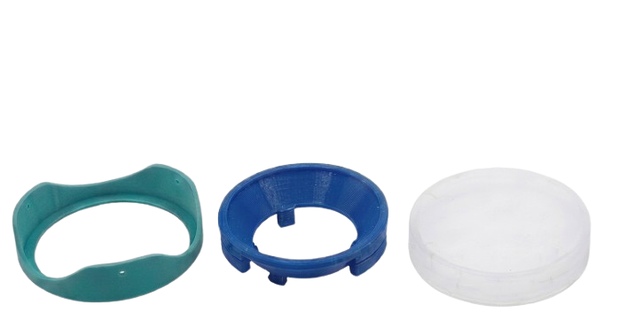<br><sub>③ Parts: ring, frame, membrane</sub></td>
<td align="center">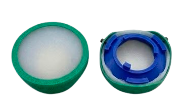<br><sub>④ Assembled palm</sub></td>
</tr>
</table>

### Lessons learned

- **Degassing**: the castings were not vacuum-degassed. Trapped bubbles act as crack initiators in the thin flexure regions and should be removed in the next iteration.
- **Food-grade silicones** would be required for real food contact.
- **Modularity**: the snap-fit finger root made it possible to iterate on finger designs without rebuilding the gripper.

---

## 6. Electronics

<div align="center">
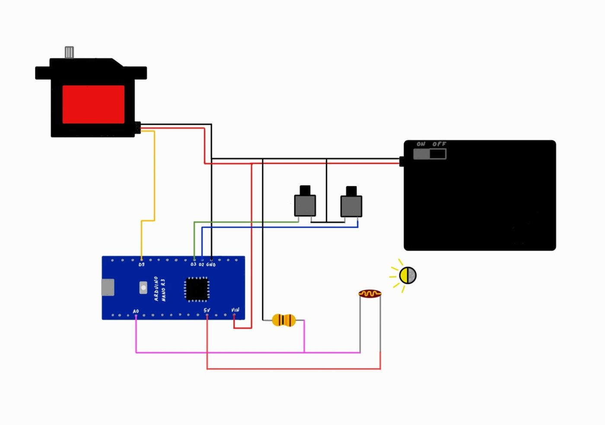
</div>

### Bill of materials

| Component | Part | Role |
|---|---|---|
| Microcontroller | Arduino Nano | Reads the sensor and buttons, drives the servo |
| Actuator | Digital servo **6221MG** | Winds the main tendon via the R = 20 mm pulley |
| Sensor | LDR (photoresistor) + **10 kΩ** resistor | Shadow detection inside the palm |
| User input | 2 × push buttons (internal pull-ups) | Calibrate / release, forced closure |
| Power | 4 × 1.5 V AA batteries | 6 V nominal pack: portable, no tether |

<div align="center">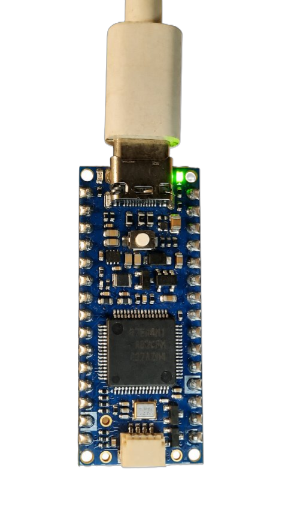</div>

### Pin map

| Pin | Signal | Mode |
|---|---|---|
| `A0` | LDR divider output | analog input |
| `D9` | Servo PWM | output |
| `D2` | Button 1 – calibrate / release | `INPUT_PULLUP` (active LOW) |
| `D3` | Button 2 – forced closure | `INPUT_PULLUP` (active LOW) |

### LDR voltage divider

The photoresistor is on the high side and the 10 kΩ resistor on the low side. When a shadow falls on the palm, the LDR resistance rises, so the voltage at `A0` **drops**:

$$
V_{A0} = V_{cc}\,\frac{R_f}{R_f + R_{LDR}(E)},\qquad R_f = 10\ \text{k}\Omega
$$

$$
N = \operatorname{round}\!\left(1023\,\frac{V_{A0}}{V_{ref}}\right)\in[0,\,1023]
$$

$R_{LDR}$ decreases with illuminance $E$ (approximately $R_{LDR}\propto E^{-\gamma}$), so $N$ increases monotonically with light.

<table>
<tr>
<td>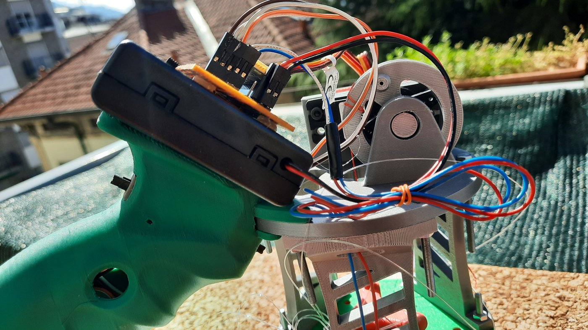</td>
<td>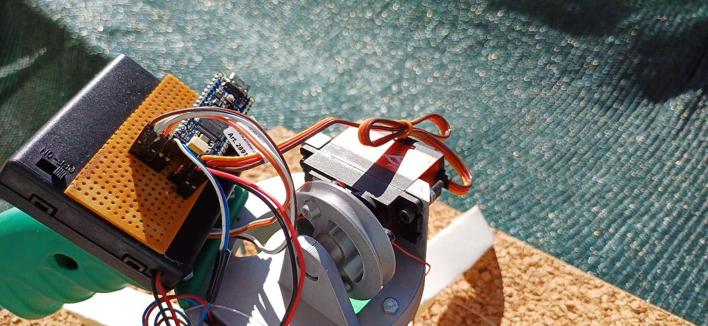</td>
<td>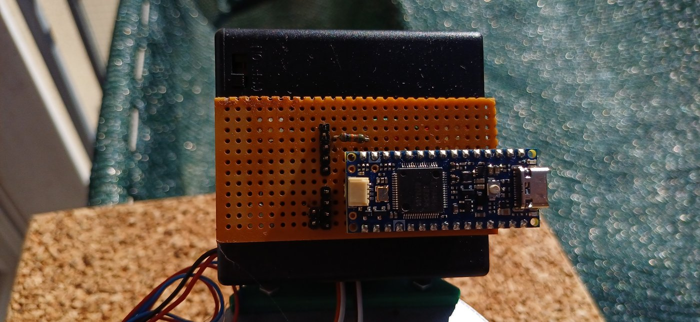</td>
<td>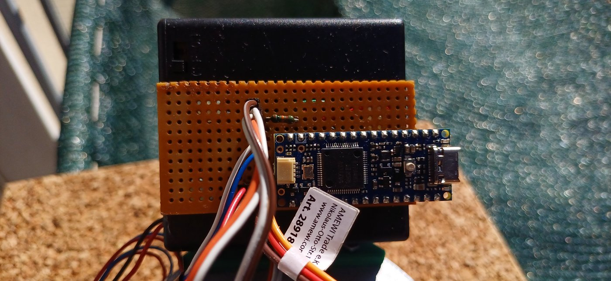</td>
</tr>
<tr><td colspan="4" align="center"><sub>Perfboard electronics mounted on the gripper body</sub></td></tr>
</table>

---

## 7. Sensing and control

### Sensing principle

<table>
<tr>
<td>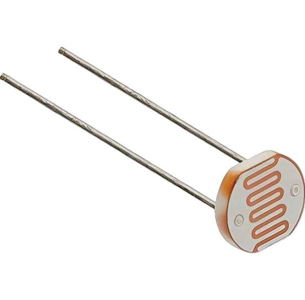</td>
<td>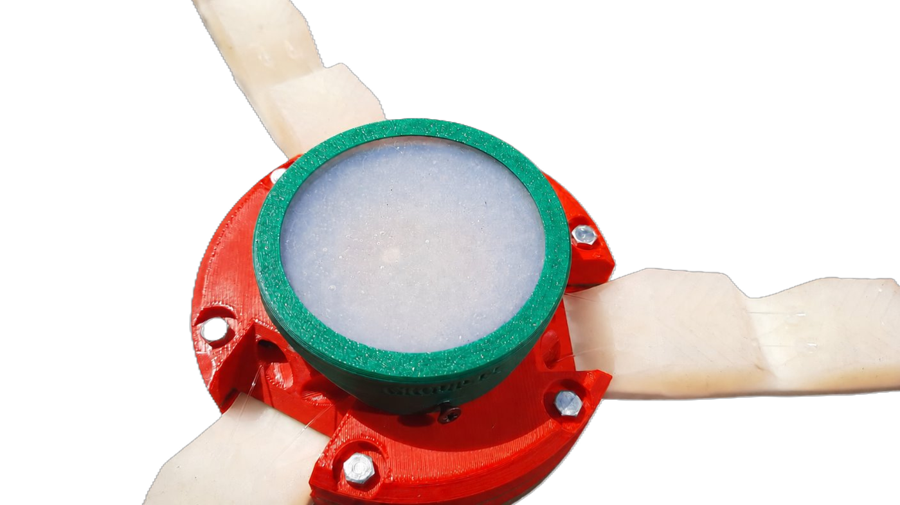</td>
<td>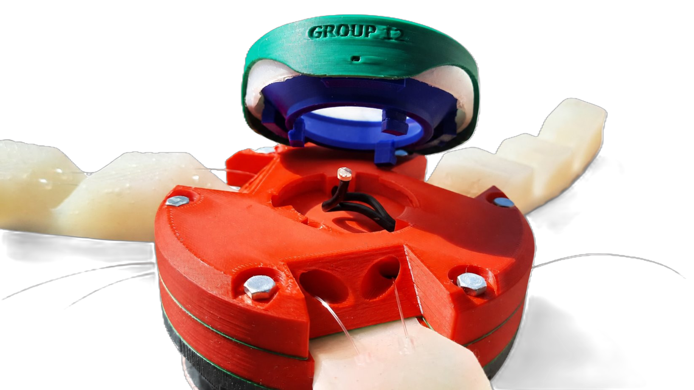</td>
</tr>
</table>

The LDR sits under the translucent palm membrane. When the gripper is lowered over an object, the object **covers the palm and casts a shadow**. The drop in light is the "object is in position" event that triggers the closure. Because ambient light varies by orders of magnitude (dark room vs. direct sun), a fixed threshold would not work. Instead, the threshold is **calibrated at start-up** as a fraction of the ambient reading:

$$
N_{th} = k\,N_{amb},\qquad k = 0.35
$$

To reject flickering and passing shadows, the closure is only triggered if the signal stays below the threshold for longer than a debounce time:

$$
\text{close} \iff N(t) < N_{th}\quad \forall\, t \in [t_0,\; t_0 + T_{deb}],\qquad T_{deb}=150\ \text{ms}
$$

With a loop period of about 50 ms, this means about 3 consecutive samples in shadow.

### Control logic (finite-state machine)

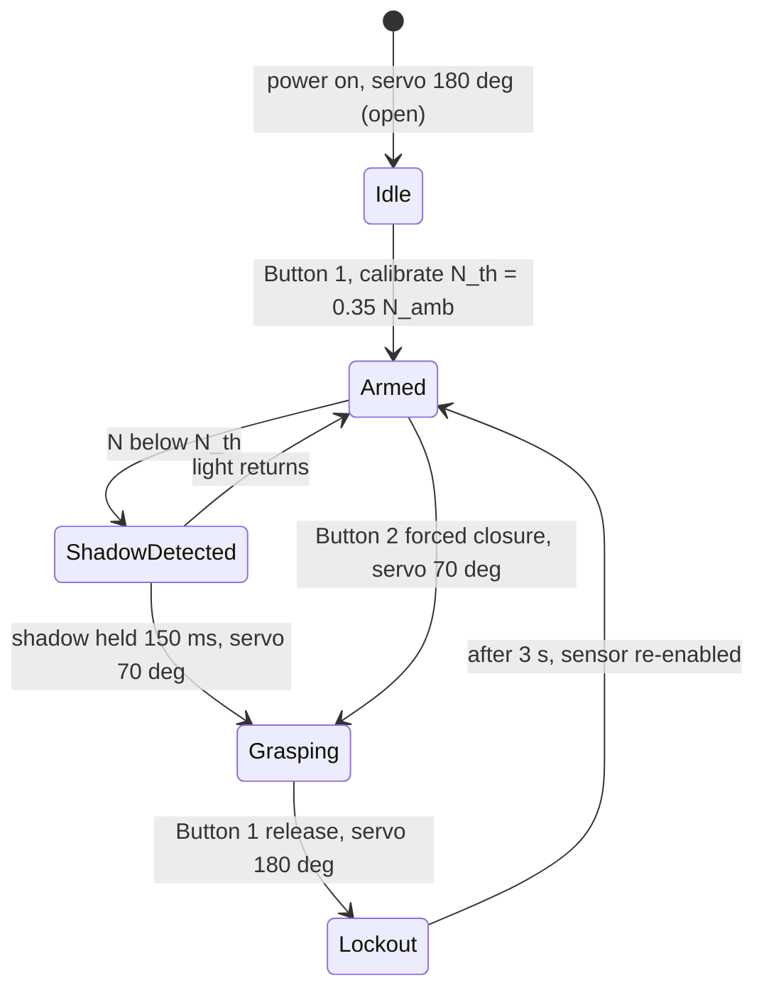

| State | Servo | Sensor | Exit condition |
|---|---|---|---|
| **Idle** | open (180°) | ignored | Button 1 → calibrate |
| **Armed** | open (180°) | sampled every ~50 ms, streamed to serial | shadow, or Button 2 |
| **Shadow detected** | open | timing | shadow lasts > 150 ms → grasp; light returns → Armed |
| **Grasping** | closed (70°) | ignored | Button 1 → release |
| **Lock-out** | open | disabled for 3 s | so that the hand or the object leaving the palm does not immediately re-trigger closure |

Both buttons use edge detection (HIGH → LOW) and a 200 ms software debounce. The full sketch is in [`firmware/soft_float_gripper/soft_float_gripper.ino`](firmware/soft_float_gripper/soft_float_gripper.ino).

<details>
<summary><b>Key firmware excerpt: calibration and shadow detection</b></summary>

```cpp
void calibra() {
  delay(500);
  int valoreAmbiente = analogRead(LDR_PIN);   // ambient reading
  soglia = valoreAmbiente * 0.35;             // threshold = 35 % of ambient
}

// in loop(), only when calibrated and not already grasping
int ldrVal = analogRead(LDR_PIN);
if (ldrVal < soglia) {
  if (tempoOmbra == 0) tempoOmbra = millis();          // shadow just appeared
  if (millis() - tempoOmbra > DEBOUNCE_OMBRA) {        // stable for > 150 ms
    presaAttiva = true;
    servo.write(ANGOLO_CHIUSO);                        // close the fingers
  }
} else {
  tempoOmbra = 0;                                      // shadow gone, reset timer
}
```
</details>

### Threshold tuning experiments

The threshold ratio $k$ was tuned **outdoors on a sunny day**, which was the most demanding condition because of strong, moving shadows from people and leaves.

<table>
<tr>
<td align="center">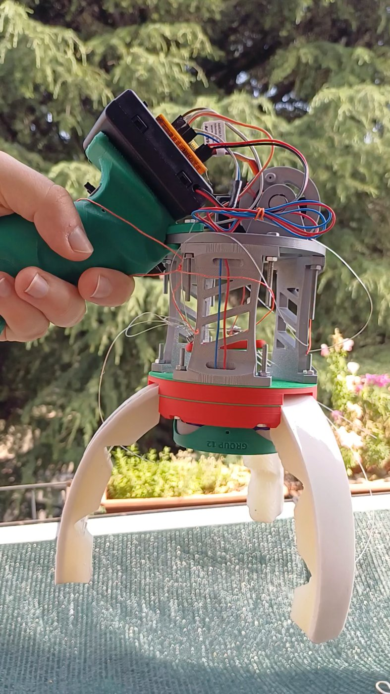<br><sub><b>k = 35 %</b></sub></td>
<td align="center"><br><sub>k = 70 %</sub></td>
<td align="center"><br><sub>k = 85 %</sub></td>
<td align="center"><br><sub>Forced closure</sub></td>
</tr>
</table>

The ratio $k$ sets how much light the object has to block before the gripper closes ($1-k$):

<div align="center">

</div>

High ratios (70–85 %) make the gripper very sensitive: a 15–30 % drop in light, like a partial shadow from the operator or the surroundings, is enough to close it. **k = 35 %** requires a 65 % light reduction, which in practice happens only when the object covers the palm. It was adopted in the final firmware (the firmware comment reads *"trigger only with a very strong shadow"*).

### Serial-monitor validation

The firmware was run with $k = 0.35$ in three lighting conditions and the serial output was logged:

<div align="center">

</div>

| Condition | Threshold printed (`Soglia`) | Implied ambient at calibration $N_{th}/0.35$ | Steady reading during test |
|---|---|---|---|
| Dark room | 11 | ≈ 31 | 21–22 |
| Indoor ambient | 67 | ≈ 191 | 197–198 |
| Outdoor, sunny | 336 | ≈ 960 | 958–969 |

The ambient level spans **about 30× between conditions**, while the threshold scales with it automatically. In every case the unshaded reading stays clearly above $N_{th}$, so there are no false triggers, and the release → 3 s lock-out → re-arm cycle behaves as designed.

<div align="center"></div>

<details>
<summary>Example serial log (dark room)</summary>

```text
LDR: 22  |  Soglia: 11
LDR: 21  |  Soglia: 11
LDR: 21  |  Soglia: 11

>> CHIUSURA FORZATA!

>> RILASCIO - apro le dita...
>> Sensore temporaneamente disabilitato...
>> Attendo 3 secondi...

>> Sensore riattivato, pronto!

LDR: 29  |  Soglia: 11
LDR: 27  |  Soglia: 11
```
</details>

---

## 8. Experimental results

The gripper was tested on objects floating in a water tank. The approach → envelop → shadow-triggered close → lift sequence worked as intended.

<table>
<tr>
<td align="center"><br><sub><b>Target object:</b> apple</sub></td>
<td align="center"><br><sub>Rectangular foam block</sub></td>
<td align="center"><br><sub>Small ball</sub></td>
<td align="center"><br><sub>Sponge</sub></td>
</tr>
</table>

<table>
<tr>
<td align="center"><br><sub>Test setup</sub></td>
<td align="center"><br><sub>Underwater view of the grasp</sub></td>
</tr>
</table>

<table>
<tr>
<td align="center"></td>
<td align="center"></td>
<td align="center"></td>
</tr>
<tr><td colspan="3" align="center"><sub>Grasps of objects with different shapes and textures</sub></td></tr>
</table>

**Observations**

- **Shape adaptation**: grasping a flat rectangular block, a sphere and a sponge with the same fingers shows the whiffletree at work, with each finger stopping at its own contact point.
- **Wet grip**: the V-groove texture and the overlapping shutter cage held the wet objects while they were lifted out of the water.
- **Reliability**: switching from single-wire to whiffletree actuation removed the stress concentration that had broken fingers in the first prototype.
- **Robust triggering** from a dark room to direct sunlight thanks to start-up calibration.

---

## 9. Conclusions and future work

The Soft-Float Gripper met its objective. It grasped apples, the target object, and also objects with very different shapes and textures. This confirms that the whiffletree adapts the fingers to the object's geometry, and that a single servo plus a cheap light sensor are enough for autonomous wet grasping.

### Limitations

- The LDR detects *presence*, not *contact force*: grip force is set by the fixed closed angle, not regulated.
- The threshold is calibrated once at start-up, so large lighting changes during operation need a re-calibration.
- Silicones used are not certified food-grade, and the castings were not degassed.

### Possible improvements

| Area | Improvement |
|---|---|
| **Sensing** | Capacitive soft sensors embedded in the fingers |
| | Resistive / piezoresistive strain sensors for force feedback and closed-loop grip |
| | Tactile optical sensors (vision-based, octopus-inspired) |
| **Design / fabrication** | Further modularity (interchangeable finger sets per product) |
| | Food-grade silicones |
| | Vacuum degassing before casting |
| **Control** | Periodic or rolling re-calibration of $N_{amb}$; current-based contact detection on the servo |

---

## 10. Team and references

**Team (Group 12)**: Thomas Monaco · Christian Menini · Simone Bucci · Erwin Rafael Novicio
Course 059250 *Soft Robotics*, Politecnico di Milano, A.Y. 2025/26.

**References**

1. M. Manti, T. Hassan, G. Passetti, N. D'Elia, C. Laschi, M. Cianchetti, "A bioinspired soft robotic gripper for adaptable and effective grasping," *Soft Robotics*, 2(3), 2015.
2. Piab AB, *piSOFTGRIP® vacuum-driven soft gripper* (product documentation).
3. Fraunhofer IVV Dresden, pneumatic elastomer grippers for food handling (project documentation).
4. K. Changizi, M. Weber, R. Kotchey, T. Pham, "Are wet-induced wrinkled fingers primate rain treads?", *Brain, Behavior and Evolution*, 2011, the inspiration for the drainage texture.
5. Smooth-On, *Smooth-Sil™* and *Ecoflex™* technical data sheets.
